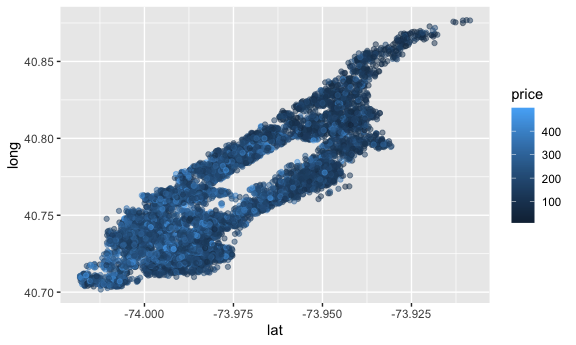
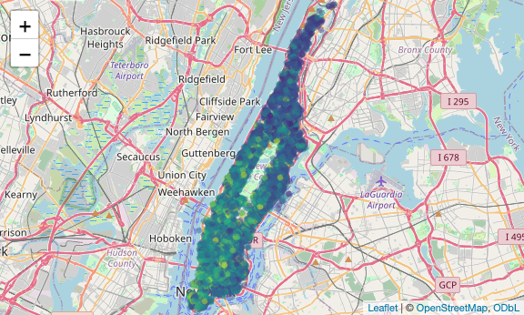

p8105_casestudy
================
Yiman Rui
2026-10-13

``` r
library(p8105.datasets)
library(tidyverse)
```

    ## Warning: package 'tibble' was built under R version 4.5.2

    ## Warning: package 'dplyr' was built under R version 4.5.2

    ## ── Attaching core tidyverse packages ──────────────────────── tidyverse 2.0.0 ──
    ## ✔ dplyr     1.2.1     ✔ readr     2.1.5
    ## ✔ forcats   1.0.1     ✔ stringr   1.6.0
    ## ✔ ggplot2   4.0.0     ✔ tibble    3.3.1
    ## ✔ lubridate 1.9.4     ✔ tidyr     1.3.1
    ## ✔ purrr     1.1.0     
    ## ── Conflicts ────────────────────────────────────────── tidyverse_conflicts() ──
    ## ✖ dplyr::filter() masks stats::filter()
    ## ✖ dplyr::lag()    masks stats::lag()
    ## ℹ Use the conflicted package (<http://conflicted.r-lib.org/>) to force all conflicts to become errors

``` r
library(ggplot2)
library(leaflet)
data(nyc_airbnb)
```

# Some questions

- where are the most expensive airbnbs in nyc?
- do description correlate with price?
- what about text reviews?

``` r
nyc_airbnb |>
  filter(neighbourhood_group =="Manhattan") |>
  count(room_type, neighbourhood) |>
  pivot_wider(
    names_from = room_type,
    values_from = n
  )
```

    ## # A tibble: 32 × 4
    ##    neighbourhood      `Entire home/apt` `Private room` `Shared room`
    ##    <chr>                          <int>          <int>         <int>
    ##  1 Battery Park City                 44             19             2
    ##  2 Chelsea                          774            274            24
    ##  3 Chinatown                        195            164             1
    ##  4 Civic Center                      25             17            NA
    ##  5 East Harlem                      433            558            57
    ##  6 East Village                    1093            742            23
    ##  7 Financial District               229            145            17
    ##  8 Flatiron District                 77             12             1
    ##  9 Gramercy                         185            116             6
    ## 10 Greenwich Village                287             93             3
    ## # ℹ 22 more rows

# price

``` r
nyc_airbnb |>
  group_by(neighbourhood_group) |>
  mutate(price_rank = min_rank(desc(price))) |>
  filter(price_rank < 3)
```

    ## # A tibble: 10 × 18
    ## # Groups:   neighbourhood_group [5]
    ##          id review_scores_location name    host_id host_name neighbourhood_group
    ##       <dbl>                  <dbl> <chr>     <dbl> <chr>     <chr>              
    ##  1 12156541                     NA One la…  6.53e7 Bobnkay   Queens             
    ##  2  3103784                     10 A Priv…  9.83e6 Michael   Brooklyn           
    ##  3 17751140                     10 Room i…  1.20e8 Sonia     Queens             
    ##  4  4737930                      8 Spanis…  1.24e6 Olson     Manhattan          
    ##  5 15556066                     NA Huge o…  1.00e8 Serin     Bronx              
    ##  6  9528920                      9 Quiet,…  3.91e6 Amy       Manhattan          
    ##  7 18051877                     NA Turn o…  2.68e6 Melissa   Staten Island      
    ##  8 16429718                     NA Charmi…  1.36e7 Lena      Brooklyn           
    ##  9 16057443                     NA Modern…  1.03e8 Mia       Bronx              
    ## 10  2176866                     NA Exclus…  1.11e7 Michael   Staten Island      
    ## # ℹ 12 more variables: neighbourhood <chr>, lat <dbl>, long <dbl>,
    ## #   room_type <chr>, price <dbl>, minimum_nights <dbl>,
    ## #   number_of_reviews <dbl>, last_review <date>, reviews_per_month <dbl>,
    ## #   calculated_host_listings_count <dbl>, availability_365 <dbl>,
    ## #   price_rank <int>

``` r
nyc_airbnb |>
  filter(price < 1000) |>
  ggplot(aes(x=price)) +
  geom_histogram() +
  facet_grid(room_type ~ neighbourhood_group)
```

    ## `stat_bin()` using `bins = 30`. Pick better value `binwidth`.

<!-- --> \##
Host stuff

``` r
nyc_airbnb |>
  filter(neighbourhood_group == "Manhattan") |>
  filter(price < 500) |>
  filter(room_type != "Shared room") |>
  mutate(neighbourhood = fct_reorder(neighbourhood, price)) |>
  ggplot(aes(x = neighbourhood, y = price)) +
  geom_boxplot() +
  facet_grid(. ~ room_type) +
  theme(axis.text.x = element_text(angle = 90, hjust = 1))
```

<!-- -->

``` r
nyc_airbnb |>
  filter(neighbourhood_group == "Manhattan") |>
  filter(room_type == "Entire home/apt") |>
  filter(price < 500) |>
  ggplot(aes(x = lat , y = long, color = price)) +
  geom_point(alpha = .5)
```

<!-- -->

make leaflet map

``` r
pal = colorNumeric(
  palette = "viridis", 
  domain = 1:500
)
nyc_airbnb |>
  filter(neighbourhood_group == "Manhattan") |>
  filter(room_type == "Entire home/apt") |>
  filter(price < 500) |>
  # sample_n(50) |>
  leaflet() |>
  addTiles() |> # the map in the background
  addCircleMarkers(~lat, ~ long, color = ~pal(price), radius = .5)
```

<!-- -->
